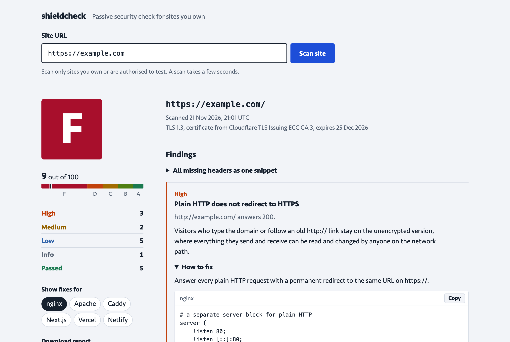
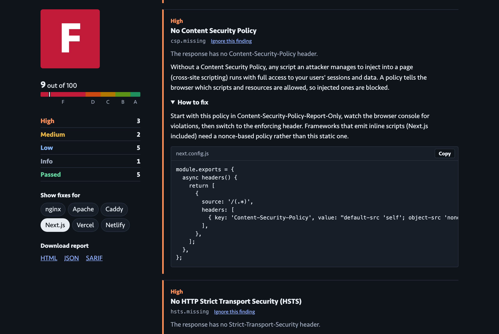

# shieldcheck

A passive security auditor for websites you own. Give it a URL and it grades the site A to F, explains every problem in plain English, and hands you the config that fixes it on nginx, Apache, Caddy, Next.js, Vercel or Netlify.

It exists because most scanners tell you a header is missing and stop there. shieldcheck is one Go binary with no dependencies that tells you why it matters and what to paste where.

> **Scan only sites you own or are authorised to test.**



## Quickstart

Download the archive for your system from the [latest release](https://github.com/Habibeyilmazz/shieldcheck/releases/latest) (Linux, macOS and Windows, amd64 and arm64), unpack it and run the binary inside:

```sh
tar -xzf shieldcheck_*_linux_amd64.tar.gz
cd shieldcheck_*_linux_amd64
./shieldcheck scan https://your-site.example
```

On Windows, unpack the `.zip` and run `shieldcheck.exe scan https://your-site.example` in the unpacked folder. `checksums.txt` on the release page has the SHA-256 of every archive. The binaries are not signed: if macOS refuses to open one downloaded with a browser, run `xattr -d com.apple.quarantine shieldcheck` once.

With Go 1.25 or newer you can install it instead:

```sh
go install github.com/Habibeyilmazz/shieldcheck@latest
shieldcheck scan https://your-site.example
```

Or build from source:

```sh
git clone https://github.com/Habibeyilmazz/shieldcheck
cd shieldcheck
go build -o shieldcheck .
./shieldcheck scan https://your-site.example --fix nginx
```

`go install` puts the binary in `$(go env GOPATH)/bin`; add that directory to your `PATH` if `shieldcheck` is not found. The examples below call it `shieldcheck`: write `./shieldcheck` when you run it from the folder it is in.

The start of a real scan of `https://example.com`:

```text
  Grade F  9/100
  https://example.com/
  3 high, 2 medium, 5 low, 1 info, 5 passed
  TLS 1.3, certificate from Cloudflare TLS Issuing ECC CA 3, expires 25 Dec 2026

  HIGH      Plain HTTP does not redirect to HTTPS  https.no-redirect
            http://example.com/ answers 200.
            Risk: Visitors who type the domain or follow an old http:// link
            stay on the unencrypted version, where everything they send and
            receive can be read and changed by anyone on the network path.
            Fix: Answer every plain HTTP request with a permanent redirect to
            the same URL on https://.
  ...
  PASSED (5)
            Certificate is valid for 34 more days
            No cookies are set by this page
            No mixed content in the page HTML
            DMARC policy is enforced (reject)
            SPF record is published
```

## What it checks

| Area | Checks |
| --- | --- |
| Security headers | Content-Security-Policy presence and quality (`unsafe-inline`, `unsafe-eval`, wildcard script sources, missing `base-uri`, report-only, meta-tag only), HSTS (`max-age`, `includeSubDomains`), clickjacking protection (`X-Frame-Options` or `frame-ancestors`), `X-Content-Type-Options`, `Referrer-Policy`, `Permissions-Policy`, COOP, CORP, version-revealing `Server` and `X-Powered-By` headers |
| TLS | Certificate trust chain, hostname match and expiry (warns under 30 days, more loudly under 14), for the site and for every HTTPS host that redirects to it; which of TLS 1.0 to 1.3 the server accepts |
| Cookies | `Secure`, `HttpOnly` (for cookies that look like sessions) and `SameSite`. Only names are reported, never values |
| Transport | Plain HTTP only, HTTP that does not redirect to HTTPS, redirect chains that drop from HTTPS to HTTP, mixed content in the page HTML |
| Email DNS | SPF (missing, duplicate, `+all`, `?all`, no `all`) and DMARC (missing, duplicate, invalid, `p=none`) |
| Disclosure | `/.well-known/security.txt` presence and `Expires` date. With `--probe`: publicly readable `/.git/HEAD` and `/.env` |

Every finding has a severity, what was observed, the risk in plain English, and a fix. Header fixes come as a snippet per platform, plus one combined snippet with all missing headers.

## Usage

```text
shieldcheck scan <url> [flags]
  --format terminal|json|sarif|html   output format (default terminal)
  --output FILE                       write the report to FILE instead of stdout
  --min-grade A|B|C|D                 exit with status 1 if the grade is worse
  --fix PLATFORM                      print fixes for nginx, apache, caddy, nextjs, vercel or netlify
  --probe                             also request /.git/HEAD and /.env
  --allow-private                     allow loopback, private and link-local addresses
  --timeout DURATION                  limit for the whole scan (default 45s)
  --no-color                          plain terminal output

shieldcheck serve [flags]
  --port N           port on 127.0.0.1 (default 4110)
  --probe            offer the /.git/HEAD and /.env probe in the UI
  --allow-private    allow loopback, private and link-local targets
```

Exit status is 0 on success, 1 when the grade is below `--min-grade`, and 2 on any error.

Some things to try:

```sh
shieldcheck scan your-site.example --fix caddy            # terminal report with Caddy snippets
shieldcheck scan your-site.example --format html --output report.html
shieldcheck scan your-site.example --format json | jq '.findings[] | select(.severity == "high") | .title'
shieldcheck scan http://localhost:3000 --allow-private    # your dev server
shieldcheck scan your-site.example --min-grade B          # for CI: fails below B
```

### Output formats

- **terminal**: coloured when stdout is a terminal, plain otherwise, with `NO_COLOR` set, and always on Windows. With `--fix`, the config for all missing headers is printed once, as one snippet, after the findings.
- **json**: the full report, including every fix for every platform.
- **sarif**: SARIF 2.1.0, one rule and one result per finding, for GitHub code scanning (see [GitHub Action](#github-action)). A website has no file to point at, so each result's location is the site written as a path (`your-site.example/`) and the full URL is in the message.
- **html**: one self-contained file with no external requests. It has the same platform switch and copy buttons as the web UI and works offline.

### Web UI

```sh
shieldcheck serve
# shieldcheck UI on http://127.0.0.1:4110 (Ctrl+C to stop)
```

The UI runs the same scan and renders the same report, with download links for the HTML, JSON and SARIF versions. It follows your system's light or dark setting.



### GitHub Action

```yaml
jobs:
  security:
    runs-on: ubuntu-latest
    steps:
      - uses: Habibeyilmazz/shieldcheck@v0.1.2
        with:
          url: https://your-site.example
          min-grade: B
```

Inputs: `url` (required), `min-grade`, `format`, `output`, `probe`, `allow-private`. The action is composite: it sets up Go, builds shieldcheck from the action's own source and runs one scan, so there is no binary download to trust. To scan a server started earlier in the same job, set `allow-private: "true"`; it is graded without the HTTPS checks (see [Grading](#grading)).

To get the findings as alerts in the repository's Security tab, write SARIF and upload it to GitHub code scanning (this workflow was run against a test site with v0.1.1 and its upload accepted):

```yaml
jobs:
  security:
    runs-on: ubuntu-latest
    permissions:
      contents: read
      security-events: write
    steps:
      - uses: actions/checkout@v5
      - uses: Habibeyilmazz/shieldcheck@v0.1.2
        with:
          url: https://your-site.example
          format: sarif
          output: shieldcheck.sarif
      - uses: github/codeql-action/upload-sarif@v4
        with:
          sarif_file: shieldcheck.sarif
```

## Grading

The score starts at 100. Each finding costs points by severity: critical 40, high 20, medium 8, low 3, info 0.

| Grade | Score |
| --- | --- |
| A | 90 to 100 |
| B | 75 to 89 |
| C | 60 to 74 |
| D | 45 to 59 |
| F | below 45, or any critical finding |

Critical findings are: no HTTPS, a certificate browsers will reject, and an exposed `.git` or `.env`.

Plain HTTP is not held against `localhost`, `*.localhost` or a loopback IP address: a dev server on your own machine is reported as "HTTPS is not graded on a local address" (info) and graded on its headers, cookies and content. HSTS, TLS and the `Secure` cookie flag can only be checked on the deployed site.

A good grade means the basics are in place. It does not mean the site is secure: shieldcheck does not look for vulnerabilities in your application.

## How it works

shieldcheck is strictly passive. One scan makes:

- one GET for the page, following up to 10 redirects by hand so every hop's headers and cookies are seen
- one GET to `http://<host>/` to see whether plain HTTP redirects to HTTPS, plus one per redirect that stays on `http://` (skipped when the scan started on `http://` or uses a non-standard port)
- five TLS handshakes: one to read the certificate, then one each for TLS 1.0, 1.1, 1.2 and 1.3, plus one for each other HTTPS host in the redirect chain
- one GET for `/.well-known/security.txt`
- TXT lookups for SPF and DMARC on the hostname and its parent domains
- with `--probe` only: one GET each for `/.git/HEAD` and `/.env`

Nothing is fuzzed, guessed or brute-forced, and no request carries a payload. Response headers over 64 KB and bodies past the first 1 MB are not read. Requests identify themselves with a `shieldcheck/<version>` user agent.

**SSRF protection.** The web UI fetches whatever URL it is given, so the scanner refuses to connect to loopback, private, link-local, carrier-grade NAT, documentation and other non-public address ranges, in IPv4 and IPv6 (including IPv4-mapped and NAT64 forms). The check runs in the dialer, on the IP address actually being connected to, so it applies to the first request, every redirect hop, the TLS handshakes, and DNS answers that change between lookups. Environment proxies are ignored, because a proxy would hide the real destination. `--allow-private` turns the check off.

**The web UI is local only.** It binds to 127.0.0.1, rejects requests whose `Host` header is not a loopback name (DNS rebinding), rejects cross-site requests using `Sec-Fetch-Site` (and will not scan for a browser too old to send that header), runs at most four scans at once and sends a strict Content-Security-Policy of its own.

**Hostile input.** Header values and page content from the scanned site are escaped in HTML and stripped of control characters in the terminal, so a site cannot inject markup or escape sequences into its own report. The contents of an exposed `.env` are never copied into a report.

### Limitations

- It looks at one URL and its redirects. It does not crawl, log in or run JavaScript, so cookies and resources added by scripts are not seen.
- Whatever the URL answers is graded. If that is an error page (a 404, or a 403 from bot protection), the report says so in an info finding, but the grade is still the error page's.
- A domain with non-ASCII letters has to be given in its `xn--` form.
- If a response has several Content-Security-Policy headers, only the first is analysed.
- Mixed content is found by pattern-matching the HTML, not by parsing it.
- The certificate chain is verified against the root store of the machine running the scan, without fetching missing intermediates. A server that omits its intermediate certificate is reported as untrusted, which is how most non-browser clients see it.
- TLS checks cover protocol versions, not individual cipher suites.
- How far the fix snippets are tested differs. CI pastes the header, exposed-dotfile and version-disclosure snippets into real nginx, Apache and Caddy (the Ubuntu packages) and requires the rescan to be an A. The TLS, HTTPS-redirect and cookie snippets, and everything for Next.js, Vercel and Netlify, were written from each platform's documentation and not run live; the header snippets for `next.config.js`, `vercel.json` and `netlify.toml` are only syntax-checked.
- SPF and DMARC are looked up on the hostname and then each parent domain down to the registrable one. There is no public-suffix list: `example.com` and common country forms such as `example.co.uk` or `example.com.tr` are recognised, a rarer suffix is not, and the lookup then goes one level too far. An SPF record found only on a parent domain is reported with a note, since SPF is not inherited. DKIM is not checked because it needs a selector name.

## Roadmap

- A container image
- Subresource Integrity check for third-party scripts and styles
- Analyse every Content-Security-Policy header, not just the first
- Job summary and grade outputs for the GitHub Action
- DNSSEC and CAA record checks
- Scan a list of URLs in one run

## Development

```sh
go test ./...        # unit and end-to-end tests against local httptest fixtures
go vet ./...
gofmt -l .
```

CI also runs the tests on macOS and Windows, runs the composite action against a fixture site and applies the generated fixes to real nginx, Apache and Caddy (`.github/scripts/live-fixes.sh`; it rewrites system config, so it is for CI runners only). Pushing a `v*` tag that matches `Version` in `internal/scan/scan.go` builds the release archives.

The code is three small packages: `internal/scan` (the checks, the SSRF guard and the fix snippets), `internal/report` (terminal, JSON, SARIF and the HTML template) and the root package (CLI and web UI). There are no third-party dependencies. See [CHANGELOG.md](CHANGELOG.md) for what changed.

## License

[MIT](LICENSE)
